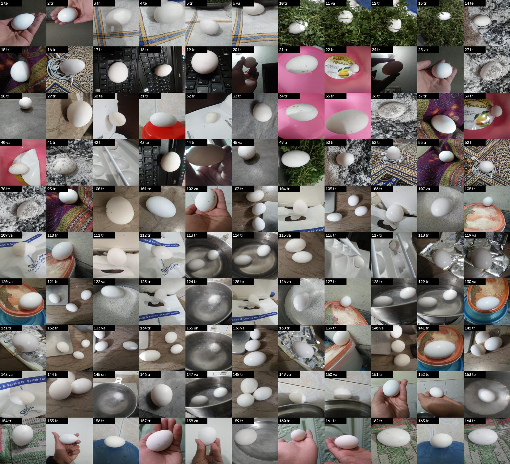
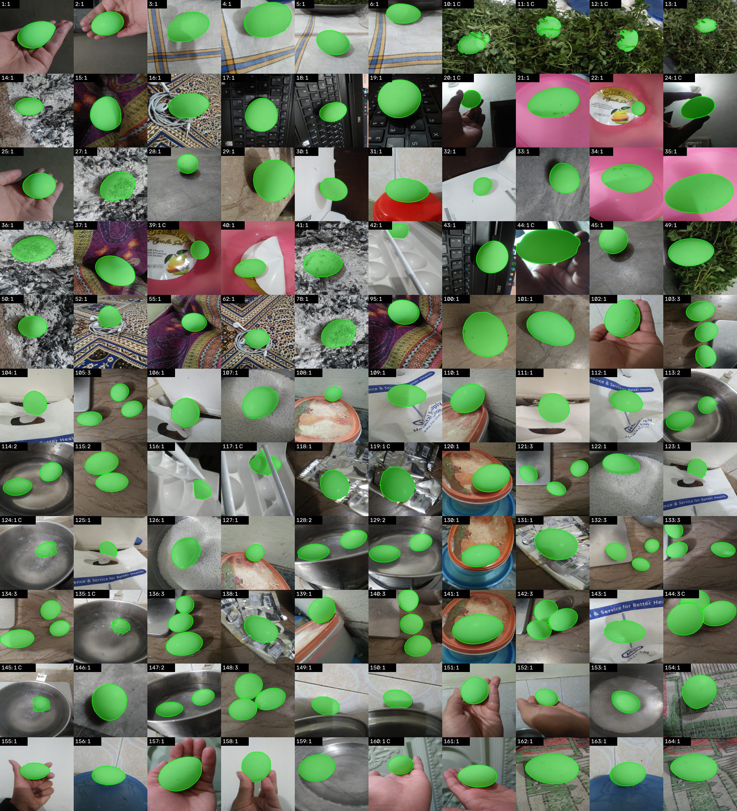
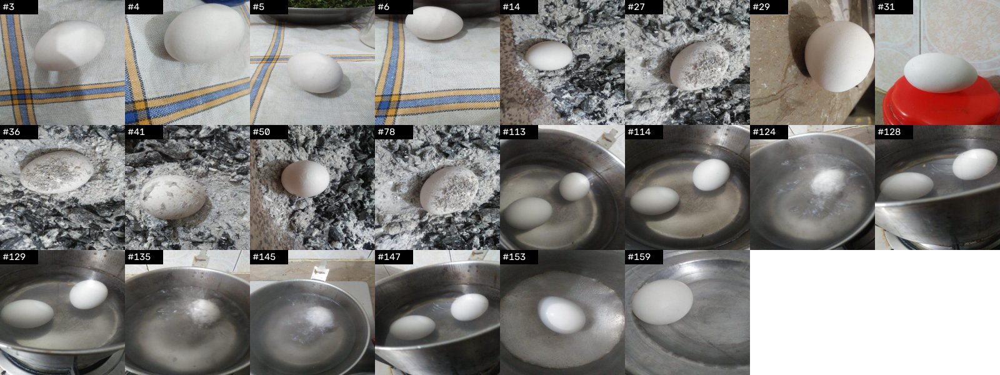
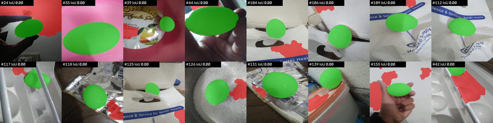
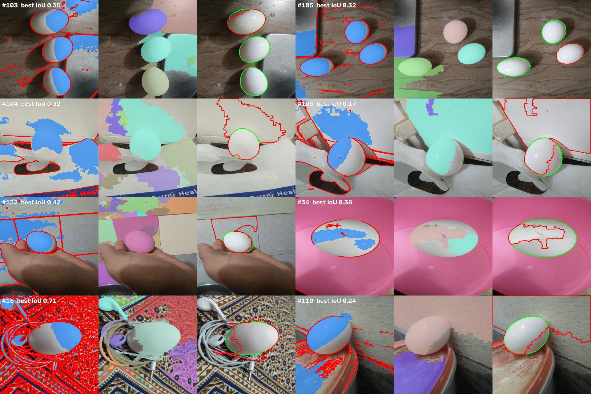
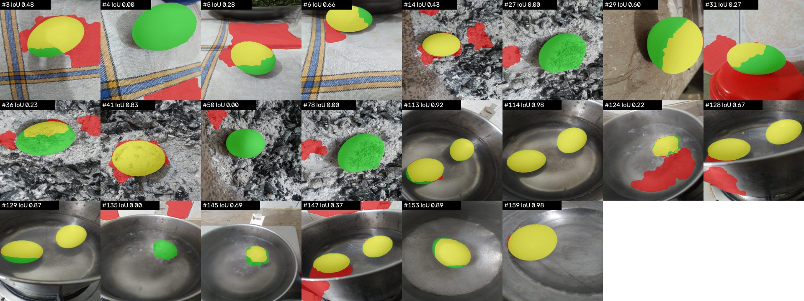
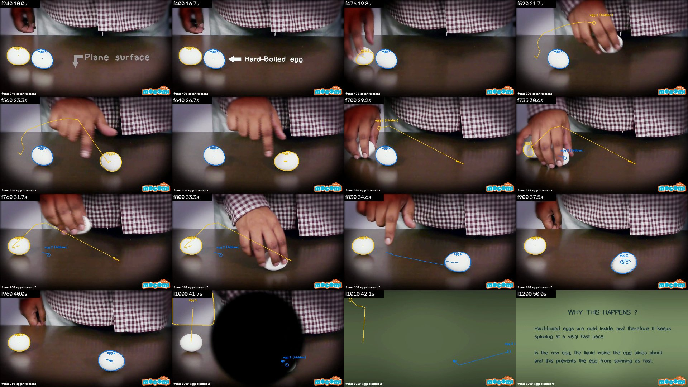

# Egg segmentation and tracking

Computer Vision Intern assignment, Nosh Robotics (Euphotic Labs). Tanmay Tiwari, October 2026.

Code: https://github.com/tanmayhutt/egg-segmentation-tracking. Tracking video: https://drive.google.com/file/d/1DC3uYRb500AILF8IBrBE3OaTCb-4HBh4/view?usp=sharing.

## 1. Summary

| Task | What was done | Result |
|---|---|---|
| 1. SAM masks | SAM ViT-B automatic mode plus a measured egg filter; 14 of 110 photos needed one hand-placed click | 110 masks, 138 eggs, all checked by eye |
| 2a. Split | 24 scene groups made by eye after three automatic grouping methods failed; whole groups dealt 4:1 with a seeded shuffle | Dev 88, eval 22, no scene on both sides |
| 2b. Classical segmenter | Eight versions, tuned on dev only, about 15 side experiments, all logged | Dev mean IoU 0.371 (baseline) to 0.524 (final) |
| 3. Evaluation | Final method run once on eval, scored against SAM | Eval mean IoU 0.472, precision 0.54, recall 0.64; baseline 0.188 |
| 4. Tracking | Classical segmenter per frame, Hungarian matching, occlusion memory, re-linking, scene-change reset | 2 IDs for 2 eggs across the whole 32 s egg segment |

Everything below was measured, not guessed. The complete trial-by-trial record, including the
attempts that made things worse, is in `docs/experiment_log.md` in the repository.

## 2. The data

110 photos, all 640x640, exported from Roboflow as a classification dataset: one label per photo
(`not_damaged`) and no masks, so Task 1 has to create the reference masks. Roboflow stretched every
photo to a square, so egg shapes are slightly distorted. Camera metadata was stripped at export.

The photos are hard on purpose: eggs on a white towel, in ash, in steel bowls of water (three while
boiling), under leaves, in hands, on a keyboard, in a pink bowl, on foil. Many scenes were shot
several times from different angles, and the photo numbers do not follow scenes (the keyboard is
#17, #18, #19 and #43). Roboflow's own train/valid/test split puts the same scene on both sides, so it
was not used.

## 3. Task 1: reference masks with SAM

**How SAM works.** An image encoder turns the photo into an embedding (about 1 s on the M2 GPU). A
prompt encoder takes a click, box or rough mask that says which object is meant. A mask decoder
returns the mask, with up to three guesses and a confidence (predicted IoU) each. SAM knows what
object boundaries look like but not object names, so it cannot be asked for "egg".

**Automatic mode.** With no clicks available, SAM's automatic mode places a 32x32 grid of points and
returns a mask for everything: eggs, hands, keys, shadows, bowls (7 to 93 masks per photo). The
slow step (`sam_candidates.py`, about 18 s per photo) saves every candidate once; the fast step
(`sam_select.py`) picks the eggs in milliseconds, so the filter could be changed without re-running SAM.

**Choosing which masks are eggs.** Rules measured on 8 sample photos:

| Rule | Why |
|---|---|
| 0.8% to 60% of the photo | Drops specks and whole-background masks |
| Brightness (HSV V) 120 or more | Eggs measured 137+; shadows, keys and ash were darker |
| Saturation 45 or less | Eggs are nearly colourless |
| Solidity 0.95 or more (area / convex hull area) | An egg has no dents; a hand does |
| Ellipse fill 0.96 or more (area / fitted ellipse area) | Eggs 0.97+, empty egg-tray cups 0.90 to 0.95 |
| One connected piece (95%+) | Rejects masks split by a rod or leaf |
| At least 25% of the biggest egg | Drops small egg-like things such as earbud heads |
| Not mostly inside a kept egg | SAM returns some eggs twice, and parts such as glare spots |

**Result.** 96 photos fully automatic. 14 needed a hand-placed click, each listed with its reason in
`config/sam_prompts.json`: leaves across the egg (solidity), dark backlit photos (brightness), eggs cut
by the frame (ellipse fill), a rod across the egg, and the three boiling-water photos where no clean
mask existed. One click is ambiguous (glare spot, egg, or the bowl), so SAM returns three guesses and
the most confident is kept; for the boiling-water photos the most confident guess was the whole bowl,
so the smallest guess (the egg) is kept for those three only. 138 eggs in total: 93 photos with one
egg, 6 with two, 11 with three. Every mask was checked by eye on the review sheet.

**Limits.** ViT-B was used (ViT-H is 2.4 GB and slower; for a simple object ViT-B gave clean edges
and no comparison was run). These masks are SAM's opinion plus a filter, not hand-drawn ground truth,
so Task 3 measures agreement with SAM. The boiling-water masks are the least certain.

## 4. Task 2a: a split without leakage

Rules tuned on photo A and scored on photo B tell nothing if A and B are the same keyboard from two
angles. So photos of one scene must land on one side. The standard way is to split by capture
session, but the export carries no metadata, and the numbering does not follow scenes (20 of the 24
scenes are spread over non-adjacent numbers).

**Three automatic groupings were tried and all failed.** Each was tested on the known same-scene sets
(keyboard #17/18/19/43, steel bowl #113/114/128/129): they must be closer to each other than to
unrelated photos.

| Fingerprint | Known same-scene pairs | Unrelated nearest neighbours | Why it fails |
|---|---|---|---|
| Perceptual hash (64 bits), Hamming distance | 18 to 34 bits | 16 to 24 bits | It fingerprints the layout of light and dark, which changes when the camera moves |
| HSV colour histogram, cosine distance | 0.09 to 0.34 | 0.0 to 0.3 | Nearly every photo is "white egg on grey or white", so histograms all look alike |
| SAM image embedding, averaged, cosine distance | 0.003 to 0.018 | 0.00 to 0.02 | Same, and averaging discards where things are |

**What was done.** All 110 photos were grouped by eye into 24 scenes (`config/scene_groups.json`);
when unsure, photos were merged, since over-merging is safe and under-merging leaks. `make_split.py`
shuffles the groups with a fixed seed and deals whole groups to eval until it holds one fifth of the
photos. The seed (21, chosen from 0 to 199) keeps eval's share of multi-egg photos (0.23 vs 0.15
overall) and of click-fixed photos (0.14 vs 0.13) close to the whole set: stratified sampling at scene
level. Result: dev 88, eval 22, exactly 4:1. Eval scenes: striped towel, ash pile, steel bowl with
water (including the three boiling photos), brown marble, red lid. Eval holds no hand photos and no
beige-marble-counter photos; the split is frozen in `config/split.json`.

## 5. Task 2b: the classical segmenter

"Classical" means no learning: hand-written rules turn pixel values into a mask. Every number in them
was chosen by measuring on the 88 dev photos. Score: mean IoU against SAM's masks over dev.

**Measurement before any rule.** Per-photo median of egg pixels vs background pixels (10th to 90th
percentile over dev): gray 168 to 209 vs 53 to 173, HSV V 172 to 215 vs 61 to 186, HSV S 4 to 24 vs 7
to 123, hue a coin flip. Brightness is the main signal and low saturation the second, but the ranges
overlap (the brightest backgrounds reach the darkest eggs), so no single fixed threshold can work.

**The final pipeline (v8), step by step.**

1. Convert to HSV. Seeds are the brightest 15% of pixels that are also colourless (S <= 80).
2. Canny edges, thickened to 5 px, are removed from the seeds, so an egg and the surface it sits on
   start as separate pieces.
3. Distance transform: inside each seed blob keep only pixels at 70% or more of the blob's deepest
   point. A fat egg keeps a solid core; a thin bridge leaking into the surface is never deep.
4. Background seeds: pixels that are dark (darkest 30%) or strongly coloured (S > 60) are not egg.
5. Watershed floods from every seed until regions meet at edges. Each egg seed becomes a region.
6. Each region is opened with a 31 px ellipse (erode, then dilate back) to cut necks into the
   surface, then smoothed to its outer outline.
7. Keep regions covering 2% to 60% of the photo with solidity >= 0.85 and ellipse fill >= 0.9. Drop
   regions under a quarter of the biggest kept one, and regions mostly inside a kept one.
8. Fallback: every photo in this dataset holds an egg, so if nothing passes, keep the single most
   egg-shaped region rather than return an empty mask.

**Every version, with what happened.**

| # | Change | Dev IoU | Under 0.5 | What the result taught |
|---|---|---|---|---|
| v1 | Grayscale, Otsu threshold, largest blob | 0.371 | 61/88 | Skin and white surfaces are bigger than the egg, so "largest" is wrong |
| v2 | Add colourless (S <= 60), opening and closing 7 px | 0.425 | 55/88 | Hands in normal light fixed; steel, paper, white bags still merge with the egg |
| v3 | Choose blobs by shape, not size | 0.283 | 59/88 | Worse, median 0. In 51 photos the egg was already merged into a bigger blob after thresholding; no later rule can split it. Lesson: measure each stage separately |
| side | Nine thresholding methods scored by "does the egg survive as its own blob" | | | Best plain threshold 45/88; watershed with edge-cut seeds 55/88. A 101 px local-contrast window scored 0 because it was smaller than the egg |
| v4 | Watershed regions, then the v3 shape filter | 0.350 | 55/88 | Regions had a 0.67 per-egg ceiling, yet the pipeline scored 0.35: the selection step was the bottleneck |
| v5 | Smooth regions; minimum area 2%; relative-size rule | 0.465 | 46/88 | Good egg regions have median area 9%, bad scraps 1%. Size separated them better than shape |
| v6 | Distance-transform seeds | 0.450 | 45/88 | Eggs with a matching region 76 -> 86 of 109; mean dipped because the selection rules were tuned for the old regions. A 96-point grid over thresholds gave at most 0.477 |
| v7 | Coloured pixels as background seeds | 0.451 | 42/88 | Median 0.45 -> 0.62, but 42 photos still at exactly 0 |
| v8 | 31 px opening to trim leaks; fallback | **0.524** | 36/88 | Zero-score photos 37 -> 15. Final |

One measurement error is also in the log: the first "does the egg survive" test compared single
regions to multi-egg masks, which capped the score at about 0.33 for three-egg photos. It was fixed
to score egg by egg.

**Where it works and fails on dev, by scene.** Marble counter 0.83 (13 photos, including every
touching-egg case), patterned cloths 0.83 to 0.84, keyboard 0.75, leaves 0.76. Hands in normal light
0.44 to 0.68. Pink bowl with a white sticker 0.36, foil 0.30, white bag 0.14, egg tray 0.10, backlit
hands 0.00 (the egg is darker than the background). The common thread: a bright surface touching the
egg with no visible edge between them. Brightness, colourlessness and edges are the only cues a
classical method has, and all three are absent there.

## 6. Task 3: evaluation on eval

Eval was run exactly once, after all tuning stopped (`scripts/evaluate.py`).

| Version | Mean IoU | Median | Precision | Recall | Under 0.5 | At 0 |
|---|---|---|---|---|---|---|
| v1 baseline | 0.188 | 0.168 | 0.206 | 0.605 | 20/22 | 7 |
| v8 final | **0.472** | 0.452 | 0.544 | 0.635 | 12/22 | 5 |
| v8 on dev, for reference | 0.524 | 0.611 | 0.605 | 0.681 | 36/88 | 15 |

**Why these metrics.** IoU (overlap over union) is the main score because it punishes both missing
egg and grabbing background. Precision says what share of our mask is really egg; recall says what
share of the egg we found. Pixel accuracy was not used: an egg covers about 5% of a photo, so an
empty mask would score 95%.

**Reading the numbers.** Dev to eval dropped by 0.05, the usual sign of mild over-tuning rather than a
collapse. The baseline scored 0.19 on the same photos, so the tuning gained about 0.28 IoU on photos
it never saw. Precision 0.54 means about half of what we call egg is not egg: extra bright regions
(towel patches, steel rims, ash). Recall 0.64 means a third of the egg is missed, mainly its shaded
side, which falls below the brightness cut.

**Per scene and failure analysis.**

- Steel bowl (10 photos): 0.66. Clear water 0.87 to 0.98. Boiling water 0.00 and 0.22: steam and
  bubbles blur the outline, and SAM's own masks there were the least certain. Bright steel rims and
  reflections are kept as extra regions.
- Ash pile (6): 0.25, three at 0.00. The egg is dusted with ash and has the same grey as the pile: no
  brightness, colour or edge difference. The fallback keeps a light ash patch instead. A clean egg
  on ash scores 0.83.
- Striped towel (4): 0.36. White cloth passes every rule an egg passes; towel patches are kept beside
  the egg, and one frame-filling egg is missed entirely.
- Brown marble (1): 0.60. Red lid (1): 0.27, the bright tiled floor joins the egg region.

The eval set has no hand or marble-counter photos and does hold the two hardest scenes, so 0.47 is
probably a slightly pessimistic estimate. It is reported as measured.

## 7. Task 4: tracking in the video

The video ("Raw and Boiled Egg Spinning", 60 s, 24 fps, 1280x720) shows two white eggs on a dark
table. A hand enters, spins each egg and carries one across the table. Title cards fill 0 to 10 s and
42 to 60 s. Output: `outputs/video/tracked.mp4` (Drive link on page 1) and `tracks.csv` (frame, time,
ID, centre, area).

**Adapting the segmenter to the frames** (allowed by the brief), measured on 16 sample frames at
640x360, fallback off so title cards return nothing:

| Change | Why | Effect |
|---|---|---|
| Minimum area 2% -> 0.4% | The two eggs measured 0.0202 and 0.0199 of the frame, one each side of the 2% cut | Both eggs found, but walls, shirt and table reflections also kept |
| Ellipse fill capped at 1.1 | A rounded rectangle over-fills its fitted ellipse; eggs sit at 0.96 to 1.03 | Small gain |
| Keep regions at least 85% as bright as the brightest kept one | Eggs measured 232 to 238; wall 141 to 150; reflections 137 | Clean: 2 eggs when visible, 1 when the hand covers one, 0 on title cards |

Photo results are unchanged.

**The tracker** (`scripts/track.py`), per frame:

1. Detect eggs with the adapted v8. Each region gives a centre, an area and a contour.
2. Match detections to existing tracks by centre distance with the Hungarian algorithm
   (`scipy.optimize.linear_sum_assignment`), which solves the whole pairing at once so two eggs never
   both grab one detection. Matches over 60 px are refused.
3. A track with no match keeps its last position for up to 5 s (the hand hides a spinning egg for up
   to 3.7 s) and is drawn as a small circle marked "hidden".
4. A detection that matches nothing nearby is offered to a hidden track with no distance limit, if
   it is between half and double that egg's area. Eggs do not appear from nowhere: a new egg while
   one is missing is that egg, carried by the hand.
5. A new track needs 12 consecutive frames (0.5 s) before it gets an ID.
6. If the frame differs a lot from the previous frame or from the frame 0.5 s earlier, all tracks are
   dropped (hard cuts and fades).

**Iterations.**

| # | Settings | IDs for 2 eggs | What went wrong |
|---|---|---|---|
| 1 | Memory 0.5 s, 3 frames to confirm | 7 | The hand carried an egg far while hiding it; it got a new ID on reappearing. A wrist and a fade each got an ID |
| 2 | Memory 3 s, 12 frames to confirm, re-link rule, hard-cut reset | 3 | One egg hidden 3.7 s by the spinning hand |
| 3 | Memory 5 s | 2 | During the iris fade the brightening wall was re-linked as egg 1, and tracks lingered onto the title card |
| 4 | Re-link needs similar area; fade detection | **2** | Egg 1 and egg 2 from 10.1 s to 41.6 s, 1281 detections, nothing on title cards |

**Limit.** The two eggs look identical, so if both were hidden at once and swapped, the IDs would swap.
That did not happen in this clip. SAM per frame was not an option: about 18 s per frame on this
machine, 7 hours for the clip, against 40 s for the whole clip with the classical method.

## 8. What I would do next

- Recover the shaded side of each found egg with a second, lower brightness threshold applied only
  inside the fitted ellipse. This targets the recall loss and would not help the zero-score photos.
- For white-on-white and ash-on-ash scenes no pixel rule works; that is where a learned model earns
  its place. SAM found clean masks on 96 of 110 photos with no tuning at all.
- Group scenes with a scene embedding (CLIP or DINOv2) instead of by eye, so the split scales.
- Evaluate against hand-drawn masks on a subset, to check how far SAM itself is from the truth.

## 9. AI tools

An AI assistant (Claude) was used as a coding aid: drafting script code, helping debug, and
explaining methods on request. The approach, the decisions at each step, the thresholds (all chosen
from numbers measured on the dev photos), the checking of every result by eye, and the experiment log
are my own work. No egg mask was produced by a language model.

## Appendix: running the code

See `README.md`. In short: create a Python 3.12 environment from `requirements.txt`, place the
dataset at `data/egg/`, the SAM weights at `weights/`, the video at `data/video/eggs.mp4`, then run
`scripts/sam_candidates.py`, `sam_select.py`, `make_split.py`, `classical.py v8 dev`,
`evaluate.py v8 eval`, `track.py` in that order. `build_report.py` rebuilds this PDF.
